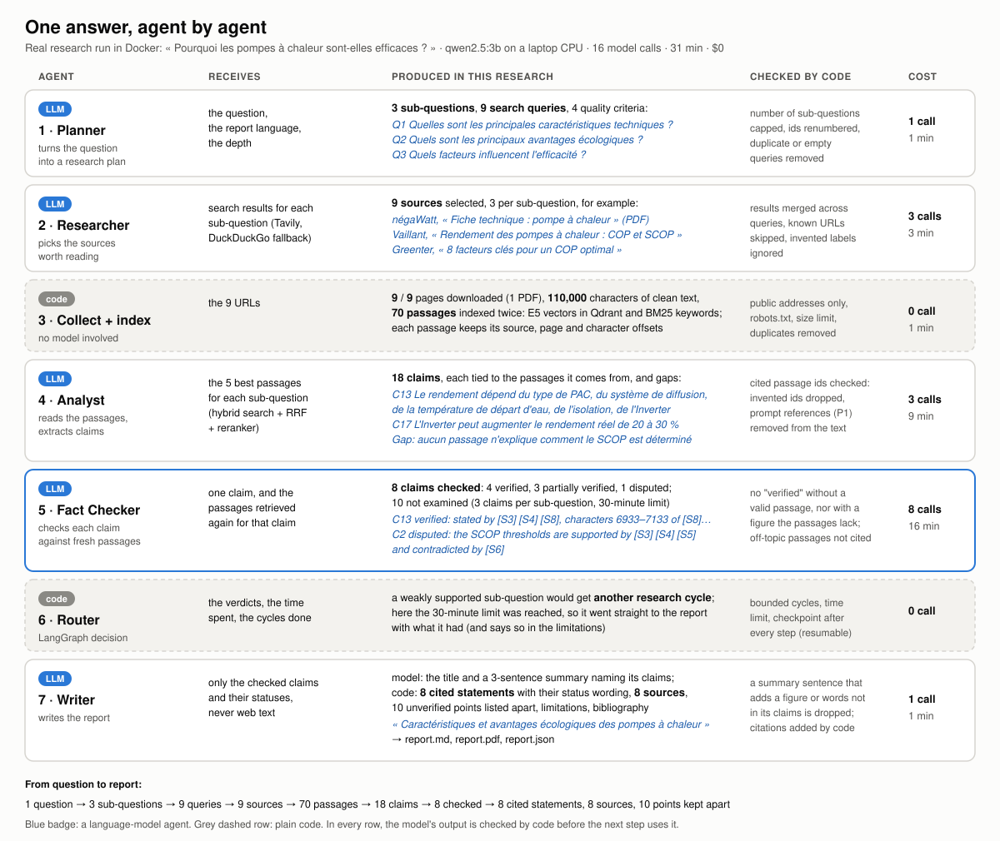
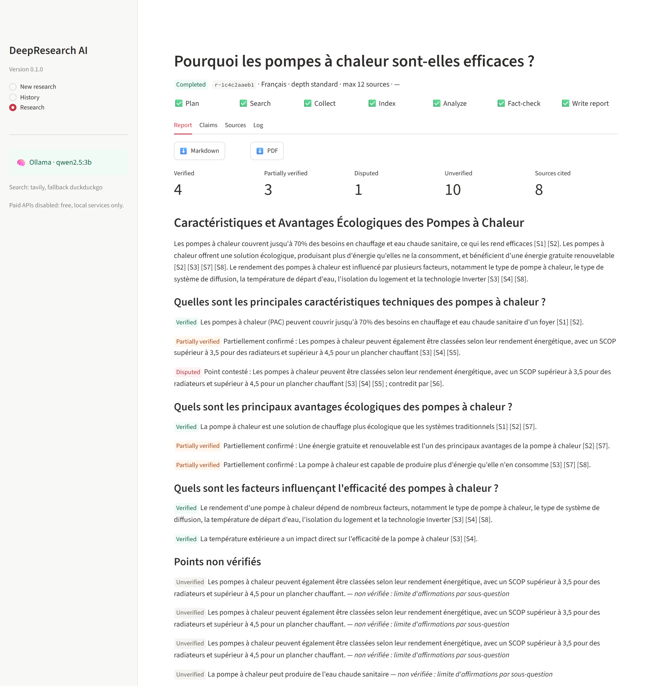
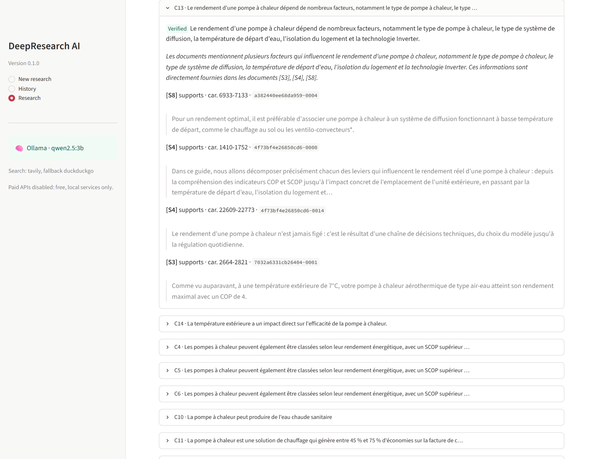

# One answer, agent by agent

What each agent does, from the Planner to the final report, followed on one real research: the question
**« Pourquoi les pompes à chaleur sont-elles efficaces ? »**, run in Docker with the local model `qwen2.5:3b` on a
laptop CPU. Every figure and excerpt below comes from that run's saved state: 16 model calls, 31 minutes, $0.

**From question to report:** 1 question → 3 sub-questions → 9 queries → 9 sources → 70 passages → 18 claims →
8 checked → 8 cited statements, 8 sources, 10 points kept apart.

Five agents call the language model. Two steps are plain code (collect and index, then the router). Every model
output is validated against a Pydantic schema, then checked by code before the next step uses it.

---

## 1. Planner: from a question to a research plan

| | |
| --- | --- |
| Receives | the question, the report language, the depth |
| Produces | an objective, sub-questions, search queries for each, quality criteria |
| Code checks | number of sub-questions capped by the depth, ids renumbered, duplicate or empty queries removed, never an empty plan |
| Cost here | 1 model call, about 1 minute |

**In this research**

- Objective: *Analyser les raisons de l'efficacité des pompes à chaleur.*
- 3 sub-questions, 3 queries each:
  - **Q1** Quelles sont les principales caractéristiques techniques des pompes à chaleur ?
  - **Q2** Quels sont les principaux avantages écologiques des pompes à chaleur ?
  - **Q3** Quels sont les facteurs influençant l'efficacité des pompes à chaleur ?
- Quality criteria: academic and scientific sources, recent and regional data, comparison with other heating
  systems, environmental and economic impacts.

## 2. Researcher: choosing what to read

| | |
| --- | --- |
| Receives | the search results of the sub-question's queries (Tavily, DuckDuckGo as fallback): title, URL, short snippet |
| Produces | the sources worth collecting, primary-source flags, complementary queries for a possible next cycle |
| Code checks | results merged and de-duplicated across queries, URLs already collected skipped, labels the model invents ignored (falls back to the search ranking) |
| Cost here | 3 model calls (one per sub-question), about 3 minutes |

**In this research**: 9 sources, 3 per sub-question, among them the négaWatt technical sheet (PDF), Vaillant's page
on COP and SCOP, Greenter's "8 key factors for an optimal COP", Viessmann's advantages and drawbacks guide and two
Saunier Duval pages on environmental impact and efficiency.

## 3. Collect and index (code, no model)

| | |
| --- | --- |
| Receives | the 9 URLs |
| Produces | clean text for each source, then passages indexed for search |
| Code checks | public addresses only (SSRF and DNS rebinding blocked), robots.txt, size limit, rate limit per site, duplicates removed |
| Cost here | no model call, about 1 minute |

**In this research**: 9 of 9 pages downloaded (1 PDF), about 110,000 characters of clean text, cut into
**70 passages** that keep their source, page and character offsets. Each passage is indexed twice: as a
multilingual E5 vector in Qdrant and as BM25 keywords.

## 4. Analyst: from passages to claims

| | |
| --- | --- |
| Receives | for each sub-question, the 5 best passages: hybrid search (vectors + BM25), Reciprocal Rank Fusion, then a reranker |
| Produces | a summary, claims tied to the passages they come from, disagreements, gaps |
| Code checks | every cited passage id must exist (invented ids dropped and counted), uncited claims kept for the Fact Checker, prompt references such as "passage P1" removed from the text |
| Cost here | 3 model calls (one per sub-question), about 9 minutes |

**In this research**: **18 claims**, 6 per sub-question, for example:

- *C13 Le rendement d'une pompe à chaleur dépend de nombreux facteurs, notamment le type de pompe à chaleur, le type
  de système de diffusion, la température de départ d'eau, l'isolation du logement et la technologie Inverter.*
- *C17 La technologie Inverter peut augmenter le rendement réel de la pompe à chaleur de 20 à 30 %.*
- *C11 La pompe à chaleur génère entre 45 % et 75 % d'économies sur la facture de chauffage par rapport à une
  chaudière gaz.*

And two gaps it reported itself: no passage explains how the COP is measured in the laboratory, nor how the
seasonal SCOP is determined. They reappear in the report's limitations.

What the run also shows: the Analyst extracted the same SCOP claim five times (C2 to C6) from different passages.
Merging near-duplicate claims before checking them is a listed next step.

## 5. Fact Checker: is each claim really stated by a source?

| | |
| --- | --- |
| Receives | one claim and the passages retrieved **again** for that claim by a fresh hybrid search (they can include the passage the claim came from) |
| Produces | a status (`VERIFIED`, `PARTIALLY_VERIFIED`, `CONFLICTING`, `UNVERIFIED`), the supporting and contradicting passages, a justification |
| Code checks | no `VERIFIED` without a valid supporting passage; `VERIFIED` with a contradicting passage becomes `CONFLICTING`; a figure of the claim missing from the cited passages makes it `PARTIALLY_VERIFIED`; supporting passages that share few of the claim's words are not cited |
| Cost here | 8 model calls (one per checked claim), about 16 minutes |

**In this research**: **8 claims checked**: 4 verified, 3 partially verified, 1 disputed. The other 10 were not
examined: the run allowed 3 checks per sub-question and stopped at 30 minutes. They are not counted as false, only as
unverified.

- *C13* is **verified**: stated by sources [S3], [S4] and [S8]; the dashboard shows the exact passages, for example
  characters 6933 to 7133 of [S8].
- *C2* (the SCOP thresholds, 3.5 for radiators and 4.5 for underfloor heating) is **disputed**: supported by [S3],
  [S4] and [S5], contradicted by [S6].
- *C7* (free and renewable energy as a main advantage) is only **partially verified**: the passages support part of it.

## 6. Router: loop again or write? (code)

| | |
| --- | --- |
| Receives | the verdicts, the time spent, the cycles already done |
| Decides | a sub-question with too few supported claims gets another research cycle, using the Researcher's complementary queries, a bounded number of times; otherwise, or when the time limit is reached, go to the report |
| Code checks | cycle limit, time limit checked before every expensive call, a checkpoint after every step so the research can be resumed |
| Cost here | no model call |

**In this research**: the 30-minute limit was reached during fact-checking, so the router went straight to the
report with what it had, and the report says so in its limitations.

## 7. Writer: the cited report

| | |
| --- | --- |
| Receives | only the checked claims, their statuses and ids; never web text |
| Produces | the title and the summary (model); everything else is built by code |
| Code checks | each summary sentence must name the claims it states, and is dropped if it adds a figure or words that are not in them; citations, sections, status wording, limitations and bibliography are written by code |
| Cost here | 1 model call, about 1 minute |

**In this research**

- Title: *Caractéristiques et avantages écologiques des pompes à chaleur*; a 3-sentence summary, every sentence
  with its citations.
- **8 cited statements** in 3 sections, each with its status wording ("Partiellement confirmé :", "Point contesté :"),
  **8 sources** in the bibliography.
- The 10 unverified claims listed apart under "Points non vérifiés", with the reason, never stated as facts.
- Limitations written by code: the research stopped at the time limit, 10 claims not examined, the two gaps found by
  the Analyst.
- Saved as Markdown, PDF and JSON: [the report](examples/heat-pump-report-fr.md) ([PDF](examples/heat-pump-report-fr.pdf)).

