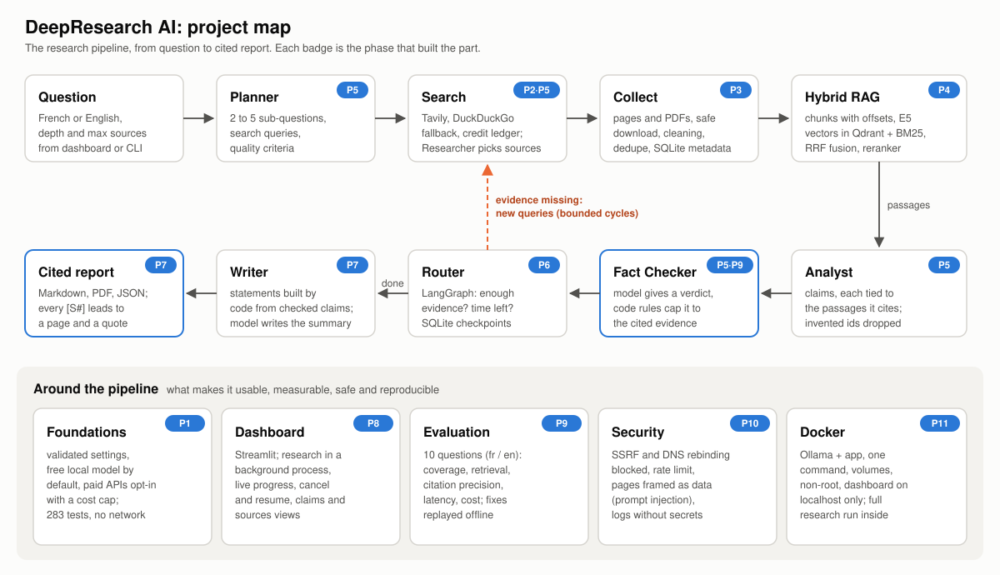
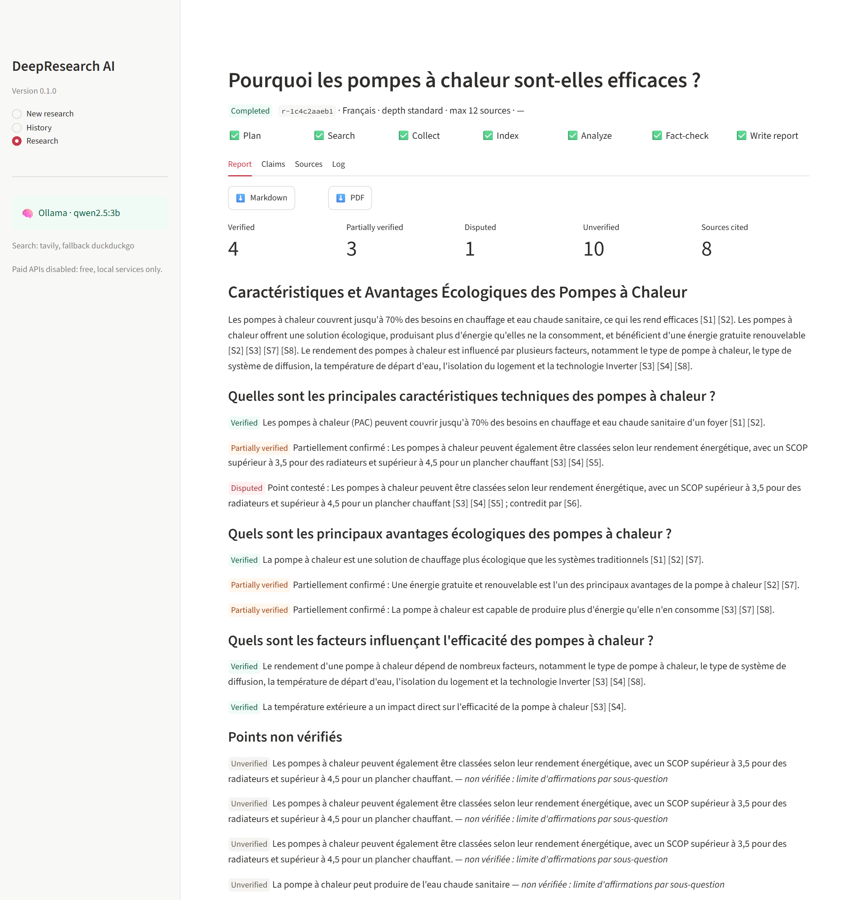
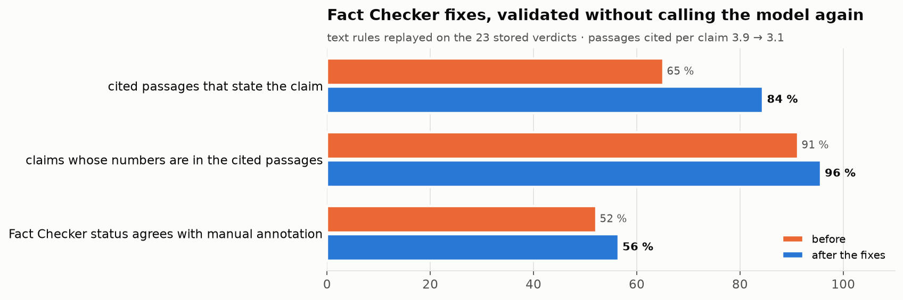

# How DeepResearch AI was built

A map of the project in 11 phases. Each phase had one goal, was tested and documented, and was validated before the
next one started. For each phase: what was built, the decision that mattered, the problem met and how it was fixed,
and the proof.

| # | Phase | Main result | Tests |
| --- | --- | --- | --- |
| 1 | [Foundations](#phase-1-foundations) | validated settings, free by default | 20 |
| 2 | [Web search](#phase-2-web-search) | Tavily with DuckDuckGo fallback, quota guard | 34 |
| 3 | [Document collection](#phase-3-document-collection) | safe download of pages and PDFs, 12 access statuses | 21 + 21 |
| 4 | [Retrieval (RAG)](#phase-4-retrieval-rag) | hybrid search: E5 + BM25, RRF, reranker | 21 |
| 5 | [Agents](#phase-5-agents) | 5 agents with structured output and code guardrails | 27 + 14 + 8 + 3 + 8 |
| 6 | [Orchestration](#phase-6-orchestration-langgraph) | LangGraph workflow, checkpoints, resume | 14 |
| 7 | [Cited reports](#phase-7-cited-reports) | every statement linked to a passage | 8 |
| 8 | [Dashboard](#phase-8-dashboard) | background jobs, progress, claims and sources views | 15 + 5 |
| 9 | [Evaluation](#phase-9-evaluation) | 10 questions, 8 metrics, 3 Fact Checker fixes | 13 |
| 10 | [Security](#phase-10-security) | SSRF, DNS rebinding, rate limit, redacted logs | 34 + 11 |
| 11 | [Docker](#phase-11-docker) | one-command stack, full research run inside | 3 |

**283 tests**, no network, no model and no credit needed to run them; 5,600 lines of application code.

---

## Phase 1: Foundations

- **Goal**: a project anyone can install and configure without risk.
- **Built**: settings validated by Pydantic ([config.py](../app/config.py)), `.env.example` documenting every setting,
  a configuration check command, a starter dashboard, the test suite.
- **Decision**: **free and local by default.** The language model runs on the laptop with Ollama (`qwen2.5:3b`);
  a paid API (Anthropic) is opt-in only, behind `ALLOW_PAID_APIS=true` and a spending cap per research. The whole
  project, evaluation included, cost **$0**.
- **Proof**: a test fails if a setting is missing from `.env.example`; an invalid configuration (paid provider without
  the opt-in) stops at startup with a clear message; keys are only ever shown as "set" or "not set".

## Phase 2: Web search

- **Goal**: search the web reliably on a free quota.
- **Built**: one interface for every search engine ([web_search.py](../app/tools/web_search.py)): Tavily first,
  DuckDuckGo as fallback; normalized results; raw answers saved for traceability.
- **Decision**: **typed errors.** An invalid key or exhausted quota is never retried; a rate limit, a server error or a
  timeout is retried with exponential backoff, honoring `Retry-After`. A local credit ledger refuses a Tavily search
  *before* it is sent once the monthly quota would be exceeded.
- **Problem**: DuckDuckGo sometimes answered "no results" to ordinary queries when its backends were blocked.
  **Fix**: an empty DuckDuckGo answer is treated as a temporary failure and retried.

## Phase 3: Document collection

- **Goal**: turn URLs into clean text without putting the machine at risk.
- **Built**: streamed download, extraction of the main content (Trafilatura) and of PDFs page by page (PyMuPDF),
  cleaning, de-duplication by URL and by content hash, metadata in SQLite.
- **Decision**: **every failure is a status, not a crash**: 12 access statuses (`ok`, `duplicate`, `unsafe_url`,
  `robots_disallowed`, `timeout`, `too_large`...), so one bad source never stops a research.
- **Problem**: a public page can redirect to `http://localhost` or a cloud metadata address (SSRF).
  **Fix**: redirects are followed one hop at a time and every target is checked again: only public addresses.

## Phase 4: Retrieval (RAG)

- **Goal**: find, among thousands of passages, those that answer a question, in French or English.
- **Built**: sentence-aware chunks that keep their page and character offsets; multilingual E5 embeddings in Qdrant;
  BM25; **Reciprocal Rank Fusion** of the two rankings; a multilingual cross-encoder reranker.
- **Problem**: the brief asked for chunks of about 800 tokens, but the embedding model reads at most 512: the last
  third of every chunk would have been cut silently. **Fix**: 480-token chunks with 15 % overlap, and the application
  refuses a chunk size the model cannot read in full.
- **Proof**: a French question finds passages in English documents; the evaluation later measured that the passage a
  claim came from is among those retrieved to check it for **96 %** of the claims.

## Phase 5: Agents

- **Goal**: five specialized agents: Planner, Researcher, Analyst, Fact Checker, Writer.
- **Built**: every model call asks for **structured output** validated by a Pydantic schema, with one corrective retry;
  web text is framed inside `<document>` tags as data, never instructions.
- **Decision**: **the model proposes, the code decides.** A small local model makes mistakes, so each agent's output is
  checked in code: invented passage ids are dropped, a `VERIFIED` verdict without a valid supporting passage becomes
  `UNVERIFIED`, a verified claim with a contradicting passage becomes `CONFLICTING`.
- **Measured**: about 50 to 95 seconds per model call on the laptop CPU.

## Phase 6: Orchestration (LangGraph)

- **Goal**: chain the agents into a research that loops when evidence is missing and never runs forever.
- **Built**: a LangGraph workflow; a sub-question with too little support gets another research cycle (bounded);
  time and claim limits; a checkpoint after every step (SQLite).
- **Decision**: **graceful degradation.** A timed-out answer becomes a gap or an unchecked claim, never a crash.
- **Problem met in the first full run** (34 minutes, 12 sources): a model timeout. **Fix**: the run resumed from its
  checkpoint without redoing the plan. The same run showed that the model cited **no source** in its report and stated
  unverified claims as facts, which led to phase 7.

## Phase 7: Cited reports

- **Goal**: a report where every statement can be traced to the passage that supports it.
- **Built**: statements built **by code** from the checked claims, with `[S#]` citations and the wording of their
  status (partially confirmed, disputed); unverified claims listed apart; limitations written by code; Markdown and
  PDF export.
- **Decision**: the model writes only the title and the summary, and each summary sentence must name the claims it
  states: a sentence that adds a number or words not in them is dropped.
- **Proof**: on the same research, **7 sources cited instead of 0**; the summary check removed a sentence that attached
  an unverified figure to an unrelated claim. [Example report](examples/heat-pump-report-fr.md) ([PDF](examples/heat-pump-report-fr.pdf)).

## Phase 8: Dashboard

- **Goal**: start, follow and read researches without the command line.
- **Built**: a Streamlit dashboard; each research runs in a **background process**, so closing the page does not stop
  it; live progress from the checkpoints; cancel and resume; report, claims (with the exact passages) and sources views.
- **Problem**: the embedded vector index accepts a single process, and the model already uses the whole CPU.
  **Fix**: one research at a time; dead processes are detected and marked *interrupted*, then resumable.

## Phase 9: Evaluation

- **Goal**: measure quality instead of assuming it.
- **Built**: 10 questions (5 French, 5 English: batteries, heat pumps, mRNA, sea level, CRISPR, nuclear power,
  transformers, GDPR, SVB, inflation), 5 expected key points each; metrics computed from what each research leaves
  behind, so scoring never reruns it: coverage, retrieval (recall and MRR), citation checks, a model judge, manual
  annotations, latency, cost.
- **Problem**: the laptop went to sleep during the overnight runs (one research took 6,867 s, others failed with model
  timeouts). **Fix**: the research process now keeps the system awake; the spoiled questions were rerun.
- **Findings**: no invented claim; 17 of 23 supported claims fully stated by their passages, 6 with a shifted date or
  scope; the Fact Checker is more often too strict than too lenient; the limit is the time budget, not retrieval
  (110 claims extracted, only 23 checked in the *quick* budget). The 3B model judge agrees with the annotation only
  52 % of the time, so annotations are the reference.
- **Fixes** (validated by replaying the rules on the stored verdicts, no model call): passages sharing few of the
  claim's words are no longer cited (cited passages that state the claim: **65 % → 84 %**); a verified claim with a
  number its passages lack becomes partial; leftover reference fragments ("as described in.") removed.

## Phase 10: Security

- **Goal**: protect keys, the machine and the models from what comes from the web.
- **Built**: connect-time address pinning, per-site rate limit (robots.txt `Crawl-delay` honored), structured JSON
  logs with secret redaction, hostile search results neutralized, dashboard on localhost with XSRF protection.
- **Problem**: the URL check resolved the host, then the HTTP client resolved it **again**: a hostile DNS server
  could answer a public address the first time and `127.0.0.1` the second (**DNS rebinding**). **Fix**: the connection
  is opened to the exact address that was checked; no second resolution.
- **Proof**: a test starts a real HTTP server on `127.0.0.1` and a resolver that answers a public address then
  `127.0.0.1`: the server is never reached. A failed research whose error contains a key stores `[TAVILY_API_KEY]`.

## Phase 11: Docker

- **Goal**: run everything with one command, on any machine with Docker.
- **Built**: an image with CPU-only PyTorch (718 MB), an unprivileged user and a healthcheck; a compose stack with
  Ollama (not exposed), a one-shot model download and the app; data in volumes; dashboard published on `127.0.0.1` only.
- **Problems**: a test read `.gitignore`, absent from the image; the command-line research did not write the JSON log.
  **Fix**: both corrected, then checked again in the container.
- **Proof**: 280 tests pass inside the container; a full French research ran end to end in Docker: 9 pages
  downloaded, 16 model calls, 8 sources cited, 31 minutes, **$0**.

---

## What the project shows

- **Reliability comes from code, not from the model.** A 3B local model is slow and fallible; the guardrails (schemas,
  verdict rules, citations built by code, limits, checkpoints) make the output traceable anyway.
- **Measure, then fix.** The evaluation turned impressions ("the Fact Checker is lenient") into numbers, which showed
  the opposite problem and where the real limit was (time budget).
- **Security is designed in**: free by default, keys never logged, the web treated as hostile.

## Limits and next steps

- The *quick* budget checks only 2 claims per sub-question: half the key points found never reach the report. A GPU
  or a hosted model would allow checking more claims.
- Some supported claims shift a date or a scope; a code rule cannot see that, a stronger model can.
- The Analyst extracts the same claim from several sources (the SCOP claim appears five times in the example):
  merging near-duplicate claims before checking would save model calls.
- The evaluation has 10 questions and annotations made by the AI assistant that built the project; an independent
  human annotation would make it stronger.
